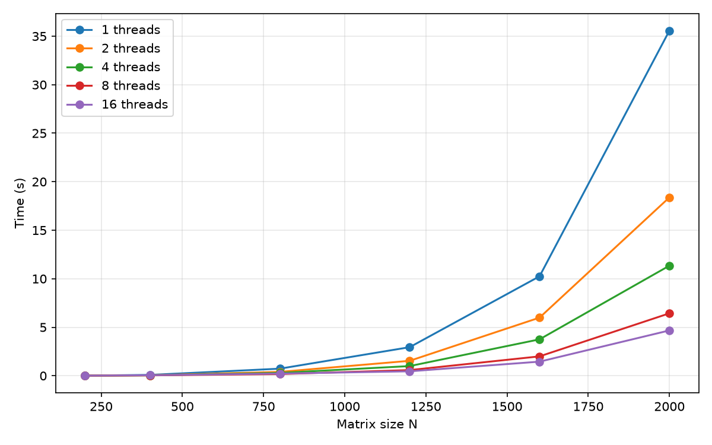
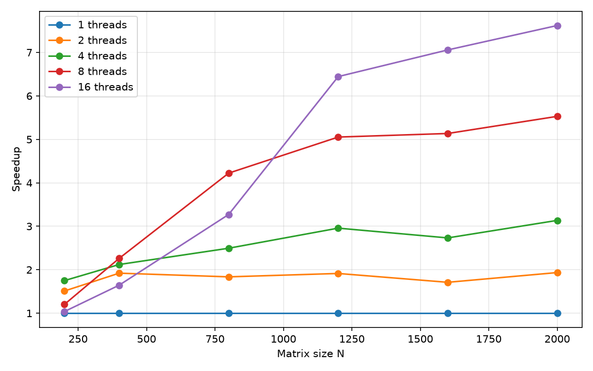
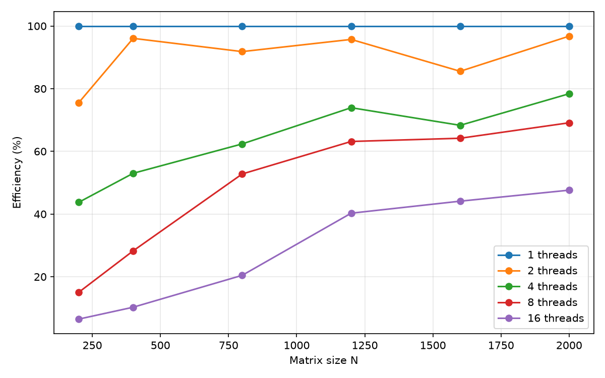

# Лабораторная работа № 2 — OpenMP

## Цель
Модифицировать программу первой лабораторной работы для параллельного умножения квадратных матриц и исследовать время вычислений.

## Алгоритм
Сохранены класс Matrix, vector<vector<double>>, три цикла ijk и формат файлов первой лабораторной. Директива `#pragma omp parallel for num_threads(threads) schedule(static)` распределяет строки результирующей матрицы между потоками. Каждый поток записывает собственные строки, поэтому гонки данных отсутствуют. Сложность O(N³). NumPy используется только для проверки.

## Запуск Windows

Запустить `run.bat` (необходимы Visual Studio с инструментами C++ и Python). Скрипт компилирует программу, устанавливает зависимости и проводит эксперименты.

## Методика экспериментов

Размеры матриц: 200, 400, 800, 1200, 1600, 2000. Количество потоков: 1, 2, 4, 8, 16. Для каждой конфигурации проведено три замера; используется медиана. Для каждого размера используются одинаковые матрицы (seed=42). Измеряется только вызов multiply, включая выделение результата и запуск потоков. Чтение, запись и проверка не входят в замер. Ускорение S = T1/Tp, эффективность E = 100*S/p. База — один поток той же программы. Количество доступных ядер фиксировано; привязка потоков к отдельным ядрам не выполнялась.

Исходные данные графиков и все отдельные замеры: [CSV](results/windows_results.csv).

## Результаты экспериментов

<!-- WINDOWS START -->

Среда: Windows 11; AMD Ryzen 9 7940HS; 8 физических ядер; 16 логических процессоров; 16 ГБ ОЗУ; MSVC /O2 /openmp. Повторений: 3. В таблице приведена медиана времени.

| N | Потоки | Время, с | Ускорение | Эффективность, % | Проверка |
|---:|---:|---:|---:|---:|:---:|
| 200 | 1 | 0.009814 | 1.000 | 100.00 | PASS |
| 200 | 2 | 0.006498 | 1.510 | 75.52 | PASS |
| 200 | 4 | 0.005609 | 1.750 | 43.74 | PASS |
| 200 | 8 | 0.008167 | 1.202 | 15.02 | PASS |
| 200 | 16 | 0.009461 | 1.037 | 6.48 | PASS |
| 400 | 1 | 0.086298 | 1.000 | 100.00 | PASS |
| 400 | 2 | 0.044918 | 1.921 | 96.06 | PASS |
| 400 | 4 | 0.040703 | 2.120 | 53.00 | PASS |
| 400 | 8 | 0.038163 | 2.261 | 28.27 | PASS |
| 400 | 16 | 0.052473 | 1.645 | 10.28 | PASS |
| 800 | 1 | 0.727734 | 1.000 | 100.00 | PASS |
| 800 | 2 | 0.396237 | 1.837 | 91.83 | PASS |
| 800 | 4 | 0.291664 | 2.495 | 62.38 | PASS |
| 800 | 8 | 0.172333 | 4.223 | 52.79 | PASS |
| 800 | 16 | 0.222434 | 3.272 | 20.45 | PASS |
| 1200 | 1 | 2.942789 | 1.000 | 100.00 | PASS |
| 1200 | 2 | 1.537205 | 1.914 | 95.72 | PASS |
| 1200 | 4 | 0.995112 | 2.957 | 73.93 | PASS |
| 1200 | 8 | 0.582399 | 5.053 | 63.16 | PASS |
| 1200 | 16 | 0.456650 | 6.444 | 40.28 | PASS |
| 1600 | 1 | 10.247722 | 1.000 | 100.00 | PASS |
| 1600 | 2 | 5.989161 | 1.711 | 85.55 | PASS |
| 1600 | 4 | 3.750327 | 2.732 | 68.31 | PASS |
| 1600 | 8 | 1.995728 | 5.135 | 64.19 | PASS |
| 1600 | 16 | 1.452009 | 7.058 | 44.11 | PASS |
| 2000 | 1 | 35.575966 | 1.000 | 100.00 | PASS |
| 2000 | 2 | 18.384256 | 1.935 | 96.76 | PASS |
| 2000 | 4 | 11.346251 | 3.135 | 78.39 | PASS |
| 2000 | 8 | 6.434032 | 5.529 | 69.12 | PASS |
| 2000 | 16 | 4.669093 | 7.619 | 47.62 | PASS |

## Выводы

- N=200: минимальное время 0.005609 с при 4 потоках, ускорение 1.75.
- N=400: минимальное время 0.038163 с при 8 потоках, ускорение 2.26.
- N=800: минимальное время 0.172333 с при 8 потоках, ускорение 4.22.
- N=1200: минимальное время 0.456650 с при 16 потоках, ускорение 6.44.
- N=1600: минимальное время 1.452009 с при 16 потоках, ускорение 7.06.
- N=2000: минимальное время 4.669093 с при 16 потоках, ускорение 7.62.

Все результаты проверены NumPy. Ускорение ограничено ресурсами процессора, памятью и накладными расходами OpenMP. Отдельные замеры сохранены в CSV. Для малых матриц накладные расходы ограничивают выигрыш от увеличения числа потоков. Для матрицы 2000 × 2000 время уменьшилось с 35,575966 до 4,669093 с (ускорение 7,62 раза, эффективность 47,62 % при 16 потоках).
<!-- WINDOWS END -->
